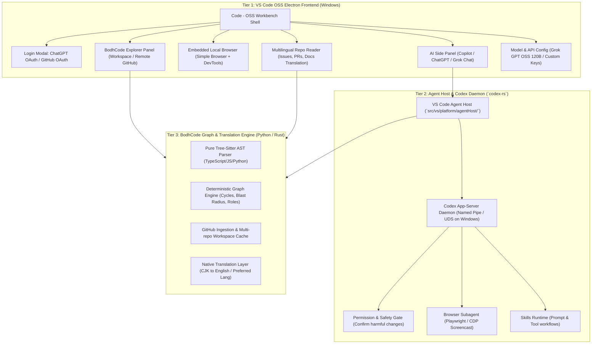
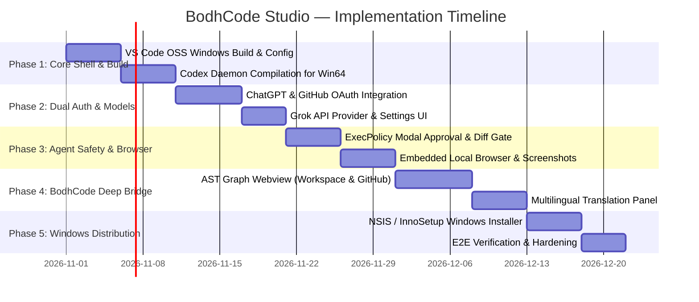

# BodhCode Studio — Unified AI IDE Architecture & Implementation Plan

> **Executive Summary**: A unified, production-ready Windows AI IDE built by fusing **VS Code OSS** (`vscode-main`), **OpenAI Codex Daemon** (`codex-main`), and **BodhCode's AST Graph & Multilingual Engine** (`backend` / `frontend`).

---

## 1. System Topology & Three-Tier Architecture



---

## 2. Deep Dive: Codebase Components & Integration Points

### A. The IDE Shell (`d:\BodhCode\vscode-main\vscode-main`)
- **Base**: `code-oss-dev` v1.145.0 with full Electron desktop runtime for Windows (`win32-x64`).
- **Existing Integration**: Contains `extensions/copilot` and `src/vs/platform/agentHost/node/codex/protocol/` which natively communicates with the Codex app-server via the protocol in `build/codex/generate-protocol.mjs`.
- **Target Additions**:
  1. **Dual Auth Welcome Experience**: A dedicated startup welcome modal providing **Login with ChatGPT** and **Login with GitHub**.
  2. **BodhCode Sidebar Activity Item**: An icon in the primary activity bar that opens the **BodhCode Knowledge & Graph Explorer** (dual mode: *Workspace* vs *Any GitHub Repo*).
  3. **Embedded Browser Action**: Built-in toolbar action opening an isolated local webview browser with screenshot capture and DOM inspection capabilities.
  4. **Settings Contributes**: Custom settings category `bodhcode.models` supporting Grok / xAI API configurations (e.g., `grok-beta`, `gpt-oss-120b`, custom endpoints).

### B. The Agent Core (`d:\BodhCode\codex-main\codex-main\codex-rs`)
- **Base**: High-performance Rust workspace (`codex-rs`) featuring `app-server`, `app-server-daemon`, `model-provider`, `tools`, `sandboxing`, `windows-sandbox-rs`, and `execpolicy`.
- **Authentication Handlers**:
  - `codex-rs/chatgpt`: Authenticates with ChatGPT accounts and sessions.
  - `codex-rs/login`: Token storage and credential manager via Windows Credential Manager (`keyring-store`).
- **Model Providers**:
  - `codex-rs/model-provider`: Add a native provider for **xAI / Grok** (`https://api.x.ai/v1`) supporting `grok-2`, `gpt-oss-120b`, and OpenAI-compatible completions.
- **Safety & Permissions**:
  - `codex-rs/execpolicy`: Intercepts file writes, destructive shell commands (`rm`, `del`, `format`, `git reset --hard`), requiring explicit user modal approval in the VS Code UI before execution.
- **Tools**:
  - `codex-rs/tools`: Exposes file read/edit, workspace search, terminal execution, CDP browser navigation, and viewport screenshots.

### C. The BodhCode Engine (`d:\BodhCode\backend` & `shared`)
- **AST Parser & Dependency Math**:
  - `backend/app/parser/`: Pure tree-sitter parser with deterministic edge sorting, CommonJS + ESM export resolution, and directory folding.
  - `backend/app/parser/blast.py`: `walk()` function for upstream blast radius and downstream dependency chains.
  - `backend/app/parser/adapters/`: Framework taxonomy and role classifiers (Next.js, NestJS, Express, React, etc.).
- **Multilingual Translation Layer**:
  - `backend/app/i18n/`: Untrusted data translation pipeline for Japanese, Chinese, Korean, etc., into English or the user's preferred language for README, issues, pull requests, and commit logs.
- **BodhCode Local Service**:
  - Runs as a lightweight local daemon or embedded fast C/Python/Node service providing `GET /workspace/graph`, `GET /workspace/routes`, `GET /workspace/explain`, and `GET /repos/translate`.

---

## 3. Feature Specifications

### 1. Dual Authentication Flow
```
App Launch ──> Has Token? 
    ├── YES ──> Restore Session (ChatGPT or GitHub)
    └── NO  ──> Display Welcome Screen with 2 Primary Actions:
                 ├── [Login with ChatGPT] ──> ChatGPT OAuth / Device Flow ──> Connects to ChatGPT Model & Workspace Files
                 └── [Login with GitHub]  ──> GitHub OAuth Flow ──> Connects to Copilot Agent & Direct Git Push
```
- In addition, the user can configure custom API keys in **Settings > BodhCode > Models > Grok API Key** to use Grok / GPT OSS 120B without external account bindings.

### 2. Side Panel Agent Tools & Permission Safeguards
Every tool call by Copilot or ChatGPT executes through `execpolicy`:
- **Read Operations** (`read_file`, `list_dir`, `search_code`): Executed immediately.
- **Browser Actions** (`open_browser`, `take_screenshot`, `click_element`): Local isolated browser window.
- **Harmful / Destructive Operations** (`edit_file`, `delete_file`, `shell_exec`, `git_push`):
  - Suspends agent execution.
  - Triggers a VS Code Notification / Modal with diff view: `"AI Agent wants to modify src/api/auth.ts (-4 lines, +12 lines). Approve?"`
  - User choices: **[Approve Once]**, **[Always Allow this Session]**, **[Reject]**.

### 3. Bottom/Side Tab: BodhCode Repository & Workspace Explorer
- Two-tab segmented switch:
  1. **Workspace Tab**: Parses the local open folder with BodhCode's AST parser, rendering an interactive React Flow / Webview dependency map with directory auto-folding and fan-in heights.
  2. **External GitHub Repo Tab**: Input field for public GitHub URL (e.g. `https://github.com/facebook/react`). Clones shallow metadata or downloads tarball, generates dependency graph, and allows asking questions ("ping") grounded against the AST.

### 4. Multilingual GitHub Repository Viewer
- Reads repository metadata, README, issues, and PRs.
- Detects non-English content (Japanese, Chinese, etc.).
- Translates content preserving Markdown syntax, code blocks, and technical identifiers into English (or user-chosen language in Settings).

---

## 4. Phased Implementation Roadmap



### Phase 1: Foundation — Windows Build & Codex Daemon Wire-up
1. Verify and configure `vscode-main` build toolchain on Windows (Node 20+, MSBuild, Python).
2. Build `codex-rs` (`app-server` binary) on Windows (`x86_64-pc-windows-msvc`).
3. Connect `vscode-main/src/vs/platform/agentHost/` to the compiled `codex.exe` daemon over named pipes (`\\.\pipe\codex-ipc`).

### Phase 2: Dual Authentication & Grok Model Configuration
1. Implement the startup login screen in VS Code's welcome subsystem:
   - ChatGPT auth flow (`codex-rs/chatgpt`).
   - GitHub OAuth flow (`extensions/copilot` / GitHub Authentication provider).
2. Add xAI / Grok model provider into `codex-rs/model-provider`:
   - Endpoint: `https://api.x.ai/v1/chat/completions`.
   - Models: `grok-2`, `gpt-oss-120b`, `grok-vision-beta`.
3. Expose settings in VS Code Preferences (`bodhcode.ai.grokApiKey`, `bodhcode.ai.defaultModel`).

### Phase 3: Agent Tools, Local Browser & Safety Gates
1. Implement `execpolicy` hooks: prompt user modal with diff preview before executing destructive file edits or shell scripts.
2. Integrate embedded browser panel (`Simple Browser` extension enhancement) with:
   - Live URL preview.
   - Screenshot tool for visual agent debugging.
   - DOM interaction tool.
3. Bundle skills directory for specialized workflows.

### Phase 4: BodhCode Graph & Multilingual Integration
1. Package BodhCode's pure tree-sitter parser and graph math as an embedded service or WASM/Node native module.
2. Create the **BodhCode Explorer Webview** in the activity bar:
   - Local workspace auto-folding graph.
   - Remote GitHub URL ingestion with graph generation.
   - Interactive chat / ping grounded against verified graph paths.
3. Add **Multilingual Viewer** tab translating foreign GitHub repos, issues, and PRs to English using the existing BodhCode translation pipeline.

### Phase 5: Windows Packaging & Release
1. Configure Electron builder for Windows installer (`.exe` NSIS installer / portable `.zip`).
2. Verify signing and update channels.
3. Run end-to-end integration test suite.
